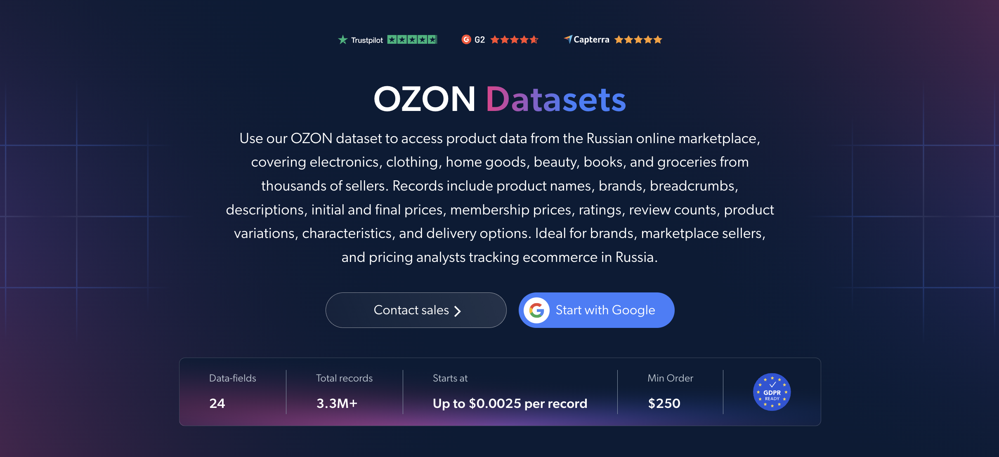

# Ozon 数据集样本

<h2>包含 1000 个 Ozon 商品的示例数据集</h2>

<a href="https://www.bright.cn/products/datasets/ecommerce/ozon">
   
</a>

包含 1000 个商品的 Ozon 数据集示例。该数据集使用 <b>Bright Data API</b> 提取。

<h2>数据集中包含的部分数据点：</h2>

* ```url```：Ozon 商品页面的 URL
* ```sku```：每个商品的唯一标识符
* ```name```：商品名称
* ```brand```：商品的品牌或制造商
* ```breadcrumbs```：从根类别到叶类别的分类路径
* ```description```：商品描述
* ```initial_price```：任何折扣前的原价
* ```final_price```：折扣后的最终价格
* ```membership_price```：Ozon Premium 会员专享价格
* ```currency```：商品价格所使用的货币
* ```rating```：平均客户评分
* ```review_count```：客户评论数量
* ```count_questions```：客户对商品的提问数量
* ```original_product```：商品是否标记为正品
* ```product_variations```：所有可用的商品变体，例如尺寸或颜色
* ```characteristics```：主要商品特性和规格
* ```product_details```：详细的商品属性
* ```delivery_options```：可用的配送选项
* ```image```：商品主图的 URL
* ```videos_url```：商品视频的 URL

以及更多数据。

这是“Ozon.ru 商品（公开数据）”数据集的示例子集，该完整数据集包含超过 <b>3,300,000 个商品</b>。

可用的数据集文件格式：<b>JSON、NDJSON、JSON Lines、CSV 或 Parquet。文件还可选择压缩为 .gz 格式</b>。

数据集交付方式选项：<b>电子邮件、API 下载、Webhook、Amazon S3、Google Cloud Storage、Google Cloud Pub/Sub、Microsoft Azure、Snowflake、SFTP</b>。

更新频率：<b>单次、每日、每周、每月、每季度、每半年或自定义</b>。

可在已提取的数据点基础上添加数据增强：<b>根据需求提供。</b>

<b>[获取完整的 Ozon 数据集](https://www.bright.cn/products/datasets/ecommerce/ozon)</b>。

<a href="https://www.bright.cn/products/datasets/ecommerce/ozon">
</a>

<h2>Ozon 数据集有哪些使用场景？</h2>

<h3>1. 定价优化</h3>
企业使用 Ozon 数据集比较竞争对手的同类商品，从而制定定价策略和动态定价模型。结合跟踪原价、最终价格和 Ozon Premium 会员价，可以揭示俄罗斯市场中的实际折扣、价格差距和最佳价格点。

<h3>2. 客户情绪与商品改进</h3>
品牌通过分析评分、评论数量和提问数量，了解消费者对特定商品或整个品牌的看法。提问很多但评论很少，通常意味着消费者对该商品感兴趣但尚未建立信任，从而表明相关商品信息和优惠需要改进。

<h3>3. 品牌与卖家分析</h3>
企业利用品牌、类别、特征和配送选项，了解各个 Ozon 类别中有哪些品牌在售，以及它们的配送条款有何差异。这有助于评估竞争对手并寻找进入该电商平台的机会。

<h2>学术研究人员和 NGO 可免费使用网页爬虫工具和数据集</h2>

Bright Initiative 项目为顶尖高校院系和研究人员，以及致力于推动各类环境与社会事业的 NGO 和 NPO，提供 Bright Data 的 <b>[网页爬虫工具 API](https://www.bright.cn/products/web-scraper)</b> 和 <b>[即用型数据集](https://www.bright.cn/products/datasets)</b>。你可以在<b>[此处](https://brightinitiative.com)</b>提交申请。
